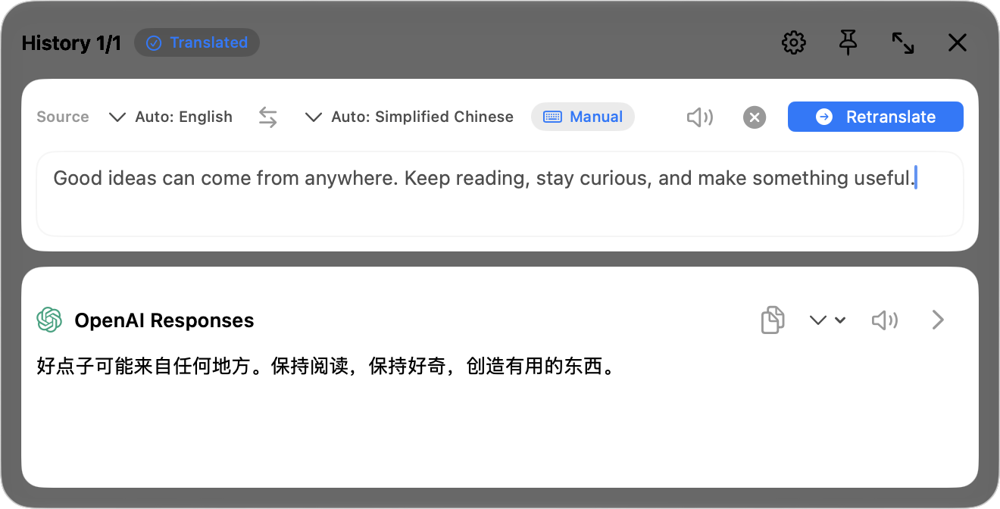
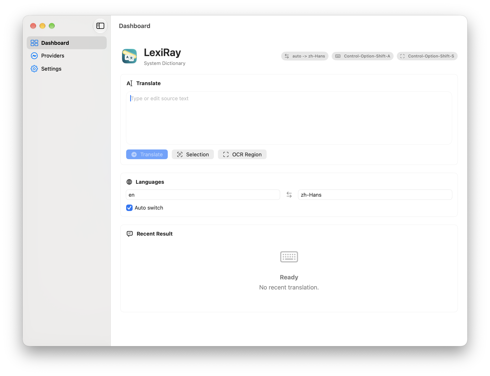
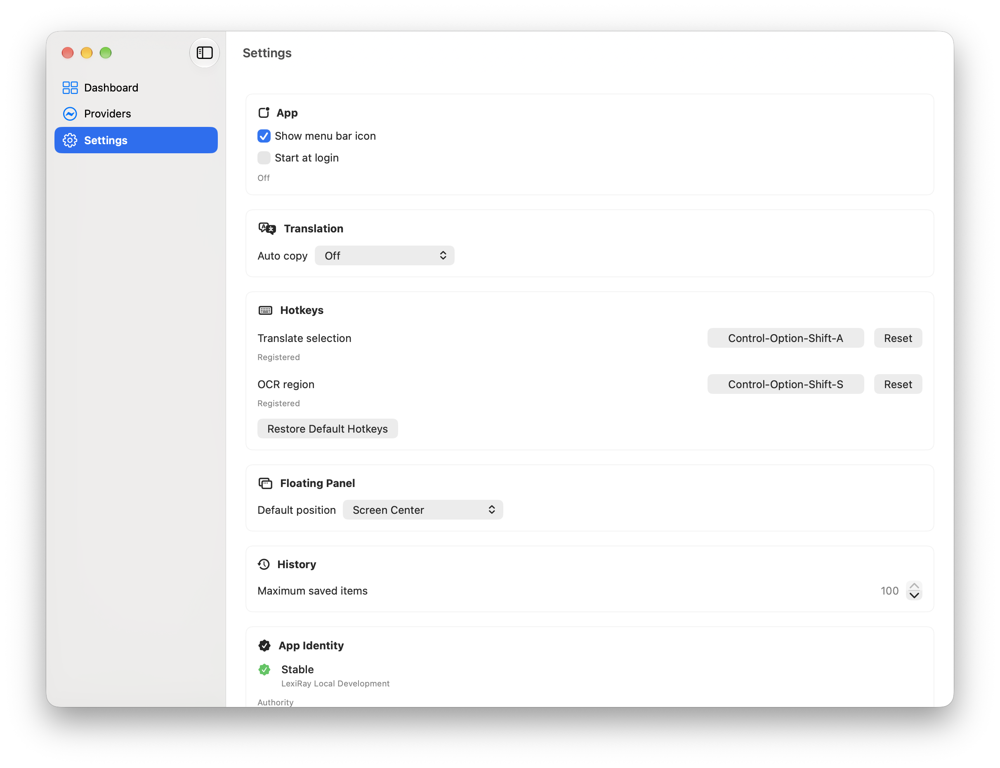
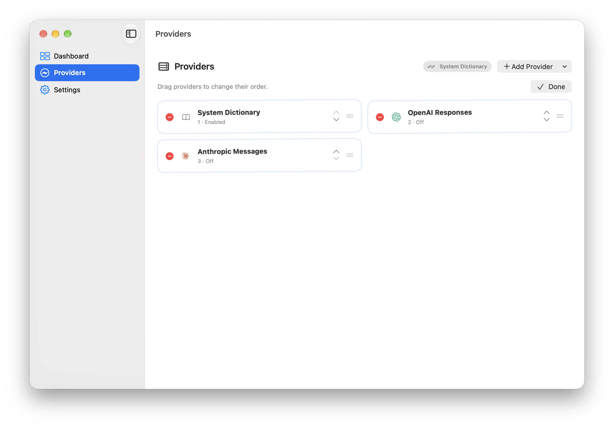

# LexiRay

LexiRay is a clean-room macOS selection translation app built with Swift and
SwiftUI. It is designed to keep translation close to the text you are reading or
writing: select text, trigger a shortcut, and get a lightweight floating panel
near your current work.



## Quick start

1. Install LexiRay in `/Applications` and open that copy.
2. Open **Providers** to configure a supported API and model, or enable the
   system dictionary. Remote providers require your own API key.
3. Grant the macOS permissions listed below when needed.
4. Select text and press **Control–Option–A**, or press **Control–Option–S**
   and drag a rectangle to recognize text on screen.

Change either shortcut in **Settings → Hotkeys**. The Dashboard also provides
**Selection** and **OCR Region** buttons.

## Features

- Menu bar app with a compact settings window.
- Global shortcuts for translating selected text and OCR regions.
- Selection reader fallback chain: Accessibility, browser AppleScript, then
  simulated copy.
- Local OCR through ScreenCaptureKit and Vision.
- Floating translation panel with provider-by-provider results.
- Translation history, retranslation, speech for both source and translated
  text, copy formats, and optional auto-copy of the first provider-ordered
  successful result.
- Provider support for the system dictionary, OpenAI Chat Completions, OpenAI
  Responses, Anthropic Messages, and Gemini GenerateContent. The mock provider is
  reserved for tests.
- Optional "Start at login" using macOS Login Items.

LexiRay requires macOS 15 or later; region OCR requires macOS 15.2 or later.

## Screenshots

### Main window

Translate text, choose languages, and open selection or region OCR from the
Dashboard.



### Settings

Adjust shortcuts, auto-copy, floating panel placement, and history preferences.



### Providers

Use **Edit** to reorder providers with drag-and-drop or keyboard controls.



These are local app screenshots with sample data from an isolated profile; the
translation shown is a demonstration fixture, with no live API requests. The
isolated profile adds Shift to the shortcuts shown in the screenshots; the
default shortcuts are listed in Quick start.

## Install

Download the latest DMG from
[GitHub Releases](https://github.com/tensornull/LexiRay/releases).

Copy `LexiRay.app` from the DMG into `/Applications`, replacing the previous
copy, then launch `/Applications/LexiRay.app`. Quit any other running copy before
using shortcuts. Downloading a release or updating source code does not replace
the installed app.

Current release builds are signed with a fixed self-signed certificate and are
not notarized. macOS Gatekeeper may still warn when opening the app. Verify the
downloaded DMG with the published `.sha256` file before installing.

The fixed release signature gives macOS a stable app identity for Accessibility
and Screen & System Audio Recording. Check **Settings → App Identity** and
**Settings → Permissions** when a workflow is unavailable. An older unsigned
installation can require granting permissions to the signed app; routine
updates should not require resetting macOS privacy permissions.

LexiRay checks its running app identity. An unsigned or ad hoc signed app, or
another running LexiRay copy with the same bundle identifier, can prevent
selection and OCR because macOS permissions depend on the app identity.

LexiRay needs these macOS permissions for its core workflows:

- Accessibility: read selected text and show the floating panel near your work.
- Screen & System Audio Recording: capture only the OCR region you select.
- Automation: read selected browser text when Accessibility cannot provide it.

## Development

Requirements:

- macOS 15+
- Xcode 16.4+ or newer
- XcodeGen

Install XcodeGen and create one temporary linked worktree from current
`origin/dev`:

```bash
brew install xcodegen
git fetch origin
git worktree add -b codex/my-change ../LexiRay-task origin/dev
cd ../LexiRay-task
git rev-parse HEAD
```

Save that starting SHA. After making the change, run:

```bash
swift run lexiray-ops verify changed --base <starting-sha>
```

The verifier maps changed paths to the narrowest build, unit, and GUI checks.
Unknown paths fail instead of expanding to a full suite. Run a named GUI
scenario directly when debugging visible behavior:

```bash
swift run lexiray-ops gui list
swift run lexiray-ops gui run panel_blank
```

Full GUI verification is restricted to shared window/panel infrastructure,
runner changes, or an explicit request. Installation and Computer Use are
restricted to macOS system boundaries or an explicit installation request.
Install only the exact verified app artifact signed with the pinned local
development or release identity. Evidence is immutable and bound to the source
fingerprint:

```bash
swift run lexiray-ops gui run --all --reason explicit
swift run lexiray-ops install --source /absolute/path/LexiRay.app
swift run lexiray-ops accept launch launch
swift run lexiray-ops accept record launch --pid 12345 --result passed
```

The acceptance launcher prints a live PID for the immediate Computer Use
handoff. The recorder verifies that process owns the isolated profile, captures
only its windows, then terminates it and removes the isolated data. The PID is
never persisted.

With explicit delivery authorization, daily delivery pushes one atomic commit
directly to `dev`. A `dev` push runs no remote CI and opens no task pull request.
Remove and prune the temporary worktree immediately after delivery. Local
installation and public release are separate actions; see
[the installation runbook](.agents/runbooks/installation.md) and
[the release runbook](.agents/runbooks/release.md).

## Release

An explicit release opens the only pull request path, `dev` to `main`. The PR
runs one required 10-minute `release-ci` job and one automatic Codex P0/P1
review. It never runs GUI or accesses signing secrets.

```bash
swift run lexiray-ops verify release-pr --base <main-sha> --head <dev-sha>
```

After merge, manually dispatch the single `Release` workflow with the exact
version and SHA. Its 20-minute, single-instance job imports the existing P12
only in the runner, builds and verifies the signed DMG, then creates the tag and
public GitHub Release. A failure creates neither. There is no local publish,
fallback builder, polling, or recovery state.

```bash
gh workflow run release.yml -f version=<version> -f sha=<exact-sha>
```

## Clean-Room Rule

LexiRay may study publicly documented product behavior from existing tools, but
must not copy GPL source code, assets, UI implementations, Objective-C, or
private reverse-engineered details.

## Contributing

See [CONTRIBUTING.md](CONTRIBUTING.md). By participating, you agree to follow
the [Code of Conduct](CODE_OF_CONDUCT.md).
